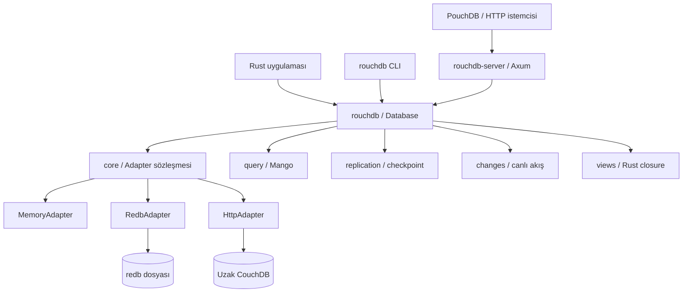
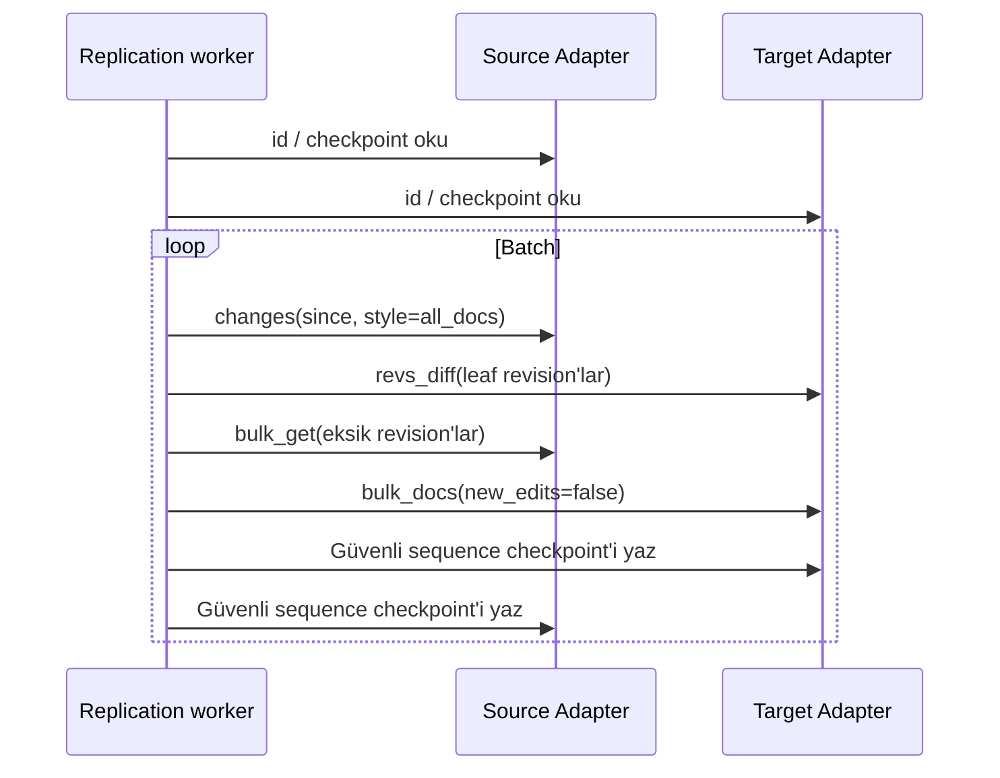

# RouchDB — kaynak koduna dayalı teknik doküman

Tarih: **14 Kasım 2026**. İncelenen commit: `d1259449bb1ad20d2df2626989b3a581b7e7893f`. Workspace sürümü: **0.5.1**. Bu metin mevcut uygulamayı anlatır; hedef mimari önerileri [denetim raporunda](DENETIM-RAPORU.md) yer alır.

## 1. Kapsam, okuma sırası ve kanıt yöntemi

Proje, Rust uygulamalarının çevrimdışı JSON belge saklamasını ve CouchDB protokolüyle eşitlemesini sağlayan bir veritabanı kütüphanesidir. Buna tek veritabanı sunan bir HTTP sunucusu, yerel dosya CLI'si ve PouchDB uyumluluk senaryoları eklenmiştir. Dağıtık CouchDB kümesinin tüm yönetim ve sorgu özellikleri uygulanmış değildir.

Bu çalışma manifestleri, temel veri yapılarını, yazma planlayıcısını, üç adapter'ın önemli okuma/yazma yollarını, facade API'sini, sorgu ve view motorlarını, checkpoint/replikasyon döngülerini, sunucu route ve güvenlik katmanlarını, CLI ve migration yollarını ve CI/test altyapısını inceler. Her satırın eksiksiz biçimde doğrulandığı, tüm yarış durumlarının elendiği veya üretim kapasitesinin ölçüldüğü iddia edilmez. Okunan alanların ve testlerin ayrıntıları [rapordadır](DENETIM-RAPORU.md).

Kanıtlar `dosya:satır` biçiminde commit'e göre verilir. Satır sayıları sonraki değişikliklerde kayabilir. [Kanıt klasörü](kanitlar/) test günlüklerini, GitNexus çıktısını, tekrar çalıştırılabilir deneyleri ve kaynak manifestini içerir. İnceleme sırasında uygulama kaynak kodu değiştirilmemiştir.

Önerilen okuma sırası: bu dokümanın mimari ve veri modeli bölümleri → replikasyon ve sunucu sözleşmeleri → [öncelikli bulgular](DENETIM-RAPORU.md#3-bulgu-özeti) → yeniden üretim kanıtları.

## 2. Teknoloji ve paket yapısı

Kök `Cargo.toml:1–36`, 13 üyeli workspace'i, edition 2024'ü, resolver 3'ü ve Rust 1.88 asgari sürümünü tanımlar. `rust-toolchain.toml` yerel geliştirme ve bloklayan CI işleri için **1.98.1** sürümünü sabitler. Gerçek denetim macOS/ARM64 üzerinde bu toolchain ile yapılmıştır.

| Crate | Sorumluluk | Başlangıç kaynağı |
|---|---|---|
| `rouchdb-core` | Belge, revision, sequence, Adapter sözleşmesi, ağaç birleştirme, yazma planlama, collation, hata tipleri | `src/document.rs`, `adapter.rs`, `write.rs`, `merge.rs` |
| `rouchdb-adapter-memory` | RAM'de depolama ve bildirim | `src/lib.rs` |
| `rouchdb-adapter-redb` | redb tabloları, transaction, compaction, format yükseltme | `src/lib.rs`, `upgrade.rs` |
| `rouchdb-adapter-http` | CouchDB HTTP istemcisi, hata eşleme, cookie auth | `src/lib.rs`, `auth.rs`, `request.rs` |
| `rouchdb-changes` | Canlı değişiklik akışı ve yaşam döngüsü olayları | `src/lib.rs` |
| `rouchdb-replication` | Tek geçiş/canlı replikasyon ve checkpoint | `src/protocol.rs`, `checkpoint.rs` |
| `rouchdb-query` | Mango selector, indeks, ad hoc map/reduce | `src/mango.rs`, `mapreduce.rs` |
| `rouchdb-views` | Design document ve closure tabanlı artımlı view | `src/design_doc.rs`, `engine.rs` |
| `rouchdb` | Uygulamaya sunulan `Database`, `Plugin`, `Partition` facade API'si | `src/lib.rs` |
| `rouchdb-server` | Axum HTTP route'ları, güvenlik, Fauxton, aktif görev görünürlüğü | `src/lib.rs`, `routes/`, `tasks.rs` |
| `rouchdb-cli` | `rouchdb` executable: CRUD, dump/import, replicate, migrate | `src/main.rs` |
| `rouchdb-bench` | Criterion veri fixture'ları ve benchmark'lar | `benches/core_ops.rs`, `revtree.rs` |
| `rouchdb-compat-tests` | crates.io'daki 0.4.0 ile dosya uyumluluğu/yükseltme testleri | `tests/redb_0_4_to_0_5.rs` |

Tablodaki crate kaynakları `crates/<crate>/` altındadır. Son üç yayın dışı paket: server, bench ve compat-tests; CLI yayınlanabilir. Kök `package.json` ana ürünü oluşturmaz: PouchDB 9 ve memory adapter'ını kuran yardımcı bir Node.js paketidir. `npm test` gerçek testleri çalıştırmaz; hata veren varsayılan komuttur. PouchDB senaryoları `run-tests.sh` ile çalışır.

Başlıca bağımlılıklar: Tokio, async-trait, serde/serde_json, redb 2.x, reqwest 0.12, Axum 0.8, tower-http 0.6, clap 4, uuid, base64, md-5. Tam çözülmüş sürümlerin kaynağı kök `Cargo.lock` dosyasıdır. Bağımlılık zafiyet veritabanı taraması bu denetimde yapılmamıştır.

## 3. Katmanlar ve bağımlılık akışı

`Adapter` storage soyutlamasıdır; `Send + Sync` ile farklı görevlerden erişilebilir. CRUD bulk işlemleri, `_changes`, revision diff, bulk fetch, attachment, local document, compact/destroy ve opsiyonel güvenlik/purge özelliklerini birleştirir. Değişiklik bildirimi `subscribe()` üzerinden opsiyoneldir. Bildirim veremeyen adapter'lar canlı işlemlerde polling ile takip edilir. Kaynak: `crates/rouchdb-core/src/adapter.rs`.

`Database` bir `Arc<dyn Adapter>`, opsiyonel uzak HTTP adapter referansı, Mango indeksleri için paylaşılan `RwLock<HashMap<...>>` ve plugin listesi tutar (`crates/rouchdb/src/lib.rs:361–375`). `Database::from_adapter` ile aynı storage üzerinde farklı facade handle'ları kurulabilir; bu handle'ların indeks cache'leri bağımsızdır (`:480–487`). Bunun reset sonrası doğruluk sınırı F03'tedir.

`Database::http` özel uzak referansı da kurar. Bu nedenle onun `find` ve indeks işlemleri CouchDB'ye aktarılır. Aynı `HttpAdapter`'ı `from_adapter` ile sarmalamak bu özel remote işaretini kurmaz; generic adapter davranışı ile facade'ın uzak sorgu davranışı aynı sanılmamalıdır.

## 4. Veri modeli

### 4.1 Belge ve revision

Bir belge `_id`, opsiyonel `_rev`, `_deleted`, kullanıcı JSON gövdesi ve attachment metadata'sından oluşur. Gövde ile protokol metadata'sının ayrıştırılması `Document::from_json`, `prepare_for_write` ve `to_json` üzerinden yapılır. `_id`/`_rev` gibi özel üyeler kullanıcı alanı gibi ele alınmaz; tanınmayan özel üyeler yazma doğrulamasında reddedilir.

Revision biçimi `generation-hash` şeklindedir. `Revision.pos` bir `u64`'tür. 32 haneli hexadecimal hash büyük harften küçük harfe normalize edilir; boş hash ve NUL reddedilir. Kaynak: `crates/rouchdb-core/src/document.rs:15–88`. Üst sınırın düzenleme sırasında artırılması şu anda güvenli değildir: F05.

Yerel yeni revision hash'i belge gövdesi, silinme durumu, parent revision ve attachment metadata'sından deterministik üretilir. CouchDB ile aynı editin aynı revision hash'ini üretmesi garanti değildir. Hash, yetkilendirme veya kriptografik imza olarak kullanılmamalıdır.

### 4.2 Revision ağacı ve conflict

`RevTree`, başlangıç generation'ı olan `RevPath` köklerinden oluşur. Her `RevNode` hash, gövdenin Available/Missing durumu, silinme durumu ve çocuklar taşır. Birden çok leaf concurrent editleri temsil eder. Kazanan revision deterministik seçilir; diğer dallar kendiliğinden birleştirilmez. Kullanıcı conflict çözümünü uygulama seviyesinde yapar.

Yerel edit bir leaf'i genişletmelidir; bu leaf'in kazanan olması şart değildir. Silinmiş belgenin yeniden yaratılması tombstone'u genişletir. Replikasyonla gelen dal mevcut ağaçla birleştirilir. Aynı revision gövdesi zaten varsa yinelenen aktarım no-op olur. Ağaç başına tutulan geçmiş yerel adapter'larda varsayılan 1000 revision/branch'tir; stemming eski revision gövdelerinin silinmesini gerektirir. Kaynak: `crates/rouchdb-core/src/write.rs:1–26,115–238`, `merge.rs:33–55`, `rev_tree.rs:13–57`.

Compaction ile purge farklıdır. Compaction leaf'lerin geçmiş gövdelerini kaldırabilir, revision ağacındaki erişilebilirlik bilgisini Missing yapar. Purge seçilen leaf ve artık gerekmeyen atalarını kalıcı kaldırır; tombstone oluşturmaz ve silinmenin kendisi peer'lere replikasyonla taşınmaz. Diğer peer'de kalan revision sonraki aktarımda geri gelebilir. Bu nedenle purge, tüm peer'lerden silme iş akışı değildir.

### 4.3 Sequence ve local document

`Seq` yerelde sayısal, CouchDB'de opaque string olabilir. Bir belge her değiştiğinde yeni sequence alır; `_changes` aynı belgenin tüm tarihsel editlerini bir audit log gibi sunmaz. En güncel değişiklik kaydı revision ağacındaki leaf'leri temsil eder.

`_local/<id>` belgeleri normal revision ağacına ve replikasyona girmez. Checkpoint bunlarda tutulur. Sunucunun local write yolu `0-N` sayacını gelen revision üzerinden artırır; normal belge MVCC'siyle aynı kabul edilmemelidir. Kaynak: `crates/rouchdb-server/src/routes/local.rs:58–86`, `crates/rouchdb-core/src/write.rs` local-document bölümü.

### 4.4 Attachment

Attachment metadata: content type, digest, length, revpos, stub/data, opsiyonel encoding/encoded_length. Yerel blob'lar MD5 digest'iyle içerik adresli tutulur. Aynı byte dizisi birden çok revision/belge tarafından paylaşılabilir.

Yeni byte'lar için digest ve length yeniden hesaplanır. Yerel editte stub, parent revision'ın aynı adlı attachment'ını tutar; bulunmayan stub hata üretir. Replicated stub storage'da ilgili blob'un varlığını gerektirir. Tombstone attachment taşımaz. Compaction/purge sonrası referansı kalmayan blob'lar temizlenir. Kaynak: `crates/rouchdb-core/src/write.rs:142–185,285–304`, `crates/rouchdb-adapter-memory/src/lib.rs:1117`.

HTTP attachment GET; doğru revision'dan metadata ve byte'ları birlikte çözer, `ETag`, `Accept-Ranges: none` ve `Content-Security-Policy: sandbox` üretir (`crates/rouchdb-server/src/routes/attachment.rs:47–114`). Range/multipart desteği varsayılmamalıdır.

## 5. Yazma yolu ve transaction sınırları

Normal facade yazması:

1. `put`/`post`/`update` belgeyi oluşturur, metadata ve derinliği doğrular.
2. `write_one` → `Database::bulk_docs` plugin `before_write` hook'larını çalıştırır.
3. Adapter shared core planlayıcıya parent ağaç ve attachment bilgilerini verir.
4. `plan_new_edit` veya `plan_replicated_edit` yazılacak gövdeyi, ağacı, blob'ları ve stemmed revision'ları üretir.
5. Adapter storage değişikliğini uygular; commit sonrası change notification yayınlar.
6. Plugin `after_write` hook'ları çalışır, sonuç facade'a döner.

Kaynak: `crates/rouchdb/src/lib.rs:534–659`, `crates/rouchdb-core/src/write.rs:115–327`, `crates/rouchdb-adapter-redb/src/lib.rs:971–988`.

Memory bulk yazması tek async write lock altında belge belge uygulanır. redb storage yazmaları `spawn_blocking` üzerinden senkron transaction'lara taşınır; `run_write` aynı adapter'ın yazmalarını sıralar. Bir bulk istekte belgeye özgü conflict/hata sonuçlarıyla diğer belgelerin yazılması mümkündür. HTTP istemcisinin bir bulk cevabını alması tüm belgelerin başarıyla yazıldığı anlamına gelmez; `DocResult` sonuçları denetlenmelidir.

redb transaction atomikliği uygulama iş akışının tamamını kapsamaz: plugin yan etkileri, iki peer'e checkpoint yazması ve persisted design document ile RAM indeksinin güncellenmesi ayrı adımlardır. `after_write` hatası commit'i geri almaz. Retry aynı rev'i yeniden yazmaya çalışırsa conflict oluşabilir; bu sözleşme `Plugin` açıklamasında açıkça belirtilmiştir (`crates/rouchdb/src/lib.rs:104–109`).

HTTP `PUT` ile silme şu anda özel bir ayrışma içerir: gövdeyi `remove` çağrısına dönüştürür ve ek tombstone alanlarını atar. Normal DELETE'in boş tombstone üretmesiyle, PUT gövdesinin korunması ayrılmalıdır. Ayrıntı: F01.

## 6. Depolama backend'leri

| Özellik | Memory | redb | HTTP |
|---|---|---|---|
| Kalıcılık | Process/adapter ömrü | Dosyada | Uzak sunucunun sorumluluğu |
| Çalıştırma | Tokio RwLock | Blocking task + redb transaction | reqwest async HTTP |
| Changes uyandırma | Broadcast | Commit sonrası broadcast | Polling |
| Kimlik | Adapter UUID | Kalıcı UUID + konum hash'i | Server UUID + DB adı; gerektiğinde URL fallback |
| Attachment | Bellekte digest deposu | `attachments` tablosu | CouchDB HTTP |
| Mango | Facade RAM indeksi/tarama | Facade RAM indeksi/tarama | `Database::http` ile uzak `_find` |
| Reset | Veri ve kimlik sıfırlanır | Tablolar/veri ve kimlik sıfırlanır | Uzak DB silinir; setup seçeneğine göre yeniden yaratılır |

### 6.1 redb dosya şeması

| Tablo | Anahtar | Değer / amaç |
|---|---|---|
| `docs` | Belge kimliği | Düzleştirilmiş revision ağacı ve current sequence |
| `rev_data` | `doc_id\0revision` | Revision gövdesi, silinme ve attachment metadata |
| `changes` | Sayısal sequence | Belge kimliği ve silinme bilgisi |
| `local_docs` | Local kimlik | Checkpoint dahil local JSON |
| `attachments` | Digest | Ham byte'lar |
| `rouchdb_meta` | Metadata anahtarı | UUID, schema, update/purge sequence, doc sayaçları, security |
| `metadata` | Format guard | 0.4'ün yeni dosyayı yanlış açmasını önleyen tip koruması |

Kaynak: `crates/rouchdb-adapter-redb/src/lib.rs:49–70,78–185`, `src/upgrade.rs:8–18,96–103`. Düz revision listesinde parent index'i tutulması uzun geçmişin serde recursion derinliğini artırmasını önler. Metadata sayaçları `info()` için tüm DB'nin taranmasını azaltır.

### 6.2 Format yükseltme ve yedek

0.4 dosyası normal `Database::open` ile sessizce yükseltilmez; `UpgradeRequired` döner. Açık `WithBackup` politikası veya CLI `migrate` gerekir. 0.5 geliştirme şemaları için ayrı yükseltme yolu vardır. Yükseltme öncesi planlama yapılır; dry-run plan raporunda durur.

Yedek, dosyayı gelişigüzel kopyalamak yerine tek read transaction'dan tablo kayıtlarını `.partial` dosyasına kopyalar; yeniden açarak karşılaştırır, sync eder, nihai ada rename eder. Asıl değişiklik two-phase commit ayarlı transaction içinde uygulanır. Yedek hedefi varsa üzerine yazılmaz. Directory sync başarısızlığında tamamlanmış yedek için warning raporlanır. Kaynak: `crates/rouchdb-adapter-redb/src/upgrade.rs:675–855,1558–1656`.

Bu tasarımın olumlu olması gerçek elektrik kesintisi ve tüm dosya sistemi senaryolarının burada test edildiği anlamına gelmez. İşletimde önce kopya üzerinde dry-run, sonra yükseltme ve yedekten geri dönüş tatbikatı yapılmalıdır. Belgelerde yaklaşık üç kat dosya boyutu kadar boş alan önerilir; bu denetim gerçek kapasite ölçümü yapmamıştır.

## 7. Sorgu motoru

### 7.1 Mango

`CompiledSelector` selector'ı önceden derler; karşılaştırma, logical combinator, regex, `$in`, `$all`, `$elemMatch`, `$allMatch`, `$keyMapMatch`, `$exists`, `$type`, `$mod` gibi koşullar desteklenir. Geçersiz selector çalışma öncesinde hata üretir. Tam operatör davranışının kaynağı `crates/rouchdb-query/src/mango.rs:645–1017`'dir.

`find_in_docs` eşleşme, sort, skip/limit ve projection uygular. Design document'lar sonuçtan çıkarılır. Sort alanı eksik belgeler sıralı sonuçlara alınmaz. İndeks yoksa adapter'dan `all_docs(include_docs=true)` alınır ve filtreleme bellekte yapılır (`mango.rs:489–605`). Küçük `limit` tam veri yüklemeyi otomatik engellemez.

`Database::find` önce uzak sorgu yoluna bakar; yerelde selector'ın ilk indeks alanını kısıtladığı bir indeks seçer. Uygun birden çok indeks varsa en küçük isim kullanılır. Seçim maliyet tabanlı optimizer değildir. İlk alanın eq/range koşulu binary search ile aday aralığını daraltır; tam selector aday belgeler üzerinde tekrar değerlendirilir (`crates/rouchdb/src/lib.rs:379–395,824–901`; `mango.rs:193–237`). İndeks güncellemesi değişen kayıtları siler/ekler ve giriş vektörünü yeniden sıralar (`mango.rs:240–296`).

Yerel indeksler RAM'dedir. Rust API `create_index` tek başına restart sonrası kalıcılık sağlamaz. HTTP `POST /_index` tanımı `language: query` design document'ına yazar; `start_server` startup'ta `restore_indexes` çağırır. `build_router` ile embed eden uygulama bu restore adımını ayrıca yönetmelidir. Persisted tanım ile RAM indeksinin aynı kalması konusunda F04 vardır. Boş alan listesi Rust API, CouchDB ve PouchDB tarafından kabul edilir; RouchDB HTTP bunu reddeder. F09, Rust validation hatası olarak değil, bu API uyum farkı olarak kaydedilmiştir.

HTTP `_find` varsayılan limit'i **25** yapar. Bookmark offset tabanlıdır: base64url içinde `skip` taşır. Snapshot veya keyset cursor değildir; sayfalar arasında belge ekleme/silme olduğunda atlama/tekrar olasılığı vardır. Boş ilk sonuçta `"nil"` döndürülüp tekrar kullanımının reddedilmesi gerçek CouchDB 3.5.1'de de gözlenmiştir; bu raporda hata olarak sınıflandırılmamıştır.

### 7.2 Sayı ve sıralama sınırları

JSON sıralaması `null < boolean < number < string < array < object` biçimindedir. String karşılaştırması UTF-16 kod birimleriyle yapılır; CouchDB'nin ICU sıralamasının aynısı değildir. Objelerde serde_json'ın sıralı map anahtarları esas alınır, CouchDB'deki yazılma sırası korunmaz (`crates/rouchdb-core/src/collation.rs:35–46`).

Varsayılan sayılar i64/u64 veya f64'tür. `arbitrary-precision` feature sayı metnini depolama ve aktarımda korur. **Bu özellik şu anda sorgulamada sınırsız hassasiyet garantisi sağlamaz:** u64 sınırı dışındaki ayrı tamsayılar f64'e çevrilip eşit kabul edilebilir; F02. Saklama doğruluğu ile sorgu doğruluğu ayrı değerlendirilmelidir.

### 7.3 Map/reduce ve ViewEngine

`query_view` Rust closure'ı üzerinden map sonuçları üretir; `_sum`, `_count`, `_stats` ve custom reducer destekler. Custom reduce tüm grup için çalışır, rereduce parametresi bu implementasyonda `false`'tur (`crates/rouchdb-query/src/mapreduce.rs:42–61`).

`ViewEngine` kayıtlı closure'larla artımlı bir indeks sürdürür. `last_seq`, live document set'i ve son change anchor'ı ile reset/purge tutarsızlıklarını fark etmeye çalışır. `stale=False` günceller, `Ok` mevcut cache'i kullanır, `UpdateAfter` cache sonucunu oluşturduktan sonra dönüşten önce günceller. İndeksler Rust `HashMap`/`BTreeMap` içinde tutulur; `PersistentViewIndex` adı disk kalıcılığı anlamına gelmez (`crates/rouchdb-views/src/engine.rs:20–55,96–200`).

HTTP'de kaydedilen JavaScript map/reduce kodu çalıştırılmaz. Var olan view'e GET/POST isteği BadRequest üretir (`crates/rouchdb-server/src/routes/views.rs:30–81`). JavaScript query server, design document filter ve `_view` changes filtresi tam CouchDB eşdeğeri değildir.

## 8. Replikasyon protokolü

`run_replication`, tek geçiş, event'li ve canlı yolların ortak çekirdeğidir (`crates/rouchdb-replication/src/protocol.rs:392–638`). `style=all_docs` ile losing conflict dalları da taşınır. Varsayılan batch 100, polling 500 ms, retry kapalı, checkpoint açıktır. `batches_limit=10` alanı vardır ancak mevcut implementasyonda etkisizdir; batch'ler sırayla işlenir (`protocol.rs:66–105`).

Checkpoint kimliği source/target adapter kimliklerinden ve filtre fingerprint'inden türetilir. DocIds sıralanıp tekilleştirilir; selector ayrı fingerprint alır. Custom closure fingerprint'lenemediği için checkpoint kullanılmaz. Source ve target aynı kimliği bildirirse checkpoint devre dışı bırakılır ve warning üretilir.

Checkpoint iki tarafta local document olarak tutulur; sürüm, session ve en fazla 50 history entry içerir. Ortak güvenli sequence bulunur. Read-only source'un checkpoint yazmayı reddetmesi için target checkpoint'ine dayanma yolu vardır (`checkpoint.rs:10–134`). İki peer transaction'ı atomik değildir; history karşılaştırması kaldığı yeri güvenli bulmaya yardımcı olur.

Hata sözleşmesi:

- Fetch, parse ve geçici belge yazma hatalarında başarısız batch'in ötesine checkpoint taşınmaz.
- `forbidden`/`unauthorized` belge hatası kalıcı red olarak kaydedilir; tek belge tüm replikasyonu sonsuza kadar durdurmaz.
- `new_edits=false` HTTP cevabı yalnız başarısız belgeleri içerebilir; başarı sayısı denenen eksi başarısız yazma olarak hesaplanır.
- `Result::Ok(ReplicationResult)` tek başına tüm belgelerin kopyalandığı anlamına gelmez; `result.ok`, `errors`, `docs_written` da okunmalıdır.
- `batch_size=0` şu anda veri taşımadan başarılı sonuç üretebilir: F06.

Canlı worker adapter bildirimleriyle uyanır; bildirim olmayan remote için polling yapar. CancellationToken tüm worker'ı sarar. Event kuyruğu bounded olduğundan event'li tek geçişte receiver eşzamanlı boşaltılmalıdır. `Active` yeni geçiş başlatır; `Change` sayaçları o geçiş içinde kümülatiftir. `ActiveTasks` her event'in farkını toplayarak lifetime sayacı üretir (`crates/rouchdb-server/src/tasks.rs:210–256`).

`Database::sync` tek geçişli push ve ardından pull yapar; iki tarafı tek atomik işlemle eşzamanlamaz (`crates/rouchdb/src/lib.rs:1198–1202`). Remote DB silinip yeniden yaratıldığında HTTP kimliği cache'de kalabilir; facade'ın destroy açıklaması live replikasyonu iptal edip `since=0`, checkpoint kapalı yeniden başlatmayı açıkça söyler (`:1210–1233`).

## 9. Plugin ve partition sözleşmeleri

Plugin `before_write`, `after_write` ve `on_destroy` hook'ları sunar. Replikasyon/attachment yazmaları `PluginAdapter` ile hook'lardan geçirilir. Replicated belge gövdesini değiştirmek source revision kimliğini bozacağından bu hook'lar o yolda kabul/red amacı taşır, değişiklikleri kaydedilmez. Drop/reject edilen belgeler per-document denial olabilir. `after_write` başarısızlığı commit sonrası hatadır; veri geri alınmaz.

`Database::adapter()` ham adapter'a erişim verir. Doğrudan adapter kullanımı facade'ın plugin ve cache yönetimini atlayabilir. Bu API'yi alan uygulama, tüm erişimleri zorunlu güvenlik hook'larından geçiren bir güven sınırı kurmuş sayılmaz. Kaynak: `crates/rouchdb/src/lib.rs:83–115,191–255,497–515`.

`Partition` belge ID'sinin `<partition>:` prefix'ine göre sorguyu daraltan Rust facade'ıdır. `_all_docs` aralıkları partition içine sıkıştırılır, `find` kapsamı kimlik koşuluyla sınırlanır. Bu bir authorization mekanizması değildir. HTTP router'da CouchDB'nin `/{db}/_partition/...` API'si uygulanmış değildir; root'taki `partitioned` feature ilanı bunu garanti etmez.

## 10. HTTP API envanteri

Gerçek route kaydı: `crates/rouchdb-server/src/routes/mod.rs:130–245`.

| Grup | Uçlar ve yöntemler | Davranış / sınır |
|---|---|---|
| Server | `GET /`, `/_all_dbs`, `/_membership`, `/_active_tasks`, `/_uuids` | Tek DB; UUID üretimi en çok 1000 |
| Session | `GET/POST/DELETE /_session` | Tek yapılandırılmış admin veya auth kapalı stub |
| UI | `GET /_utils`, `/_utils/`, `/_utils/*` | Build'e gömülü Fauxton; asset yoksa placeholder |
| DB | `GET/PUT/POST/DELETE /{db}` ve son slash'lı eşdeğeri | Bilgi, silme sonrası yeniden açma, auto-ID belge, destroy |
| Belgeler | `GET/PUT/DELETE /{db}/{docid}` | Rev, conflict, revs, revs_info, latest, attachments, open_revs |
| Liste | `GET/POST /{db}/_all_docs` | Keys, aralık, skip/limit, include_docs |
| Bulk | `POST /{db}/_bulk_docs`, `/_bulk_get`, `/_revs_diff` | Replikasyonun temel uçları |
| Changes | `GET/POST /{db}/_changes` | normal, longpoll, continuous/live, eventsource |
| Query | `POST /{db}/_find`, `/_explain` | Mango; plan ve hata gizleme sınırları raporda |
| Index | `GET/POST /{db}/_index`, DELETE index path'leri, POST `_bulk_delete` | Persisted design tanımları + RAM cache |
| Maintenance | `POST /{db}/_compact`, `/_purge` | DB info purge state değişimini yansıtmıyor: F08; değer opak kabul edilir |
| Security | `GET/PUT /{db}/_security` | Belge saklama; çok kullanıcılı ACL motoru sağlamaz |
| Local | `GET/PUT/DELETE /{db}/_local/{id...}` | Checkpoint/local belge |
| Design | `GET/PUT/DELETE /{db}/_design/{ddoc}`, GET `_info` | Tanım saklama; JavaScript çalıştırma yok |
| View | `GET/POST /{db}/_design/{ddoc}/_view/{view}` | Kayıt var; JavaScript view için BadRequest |
| Attachment | `GET/PUT/DELETE /{db}/{docid}/{attname...}` | Byte aktarımı, attachment adı slash içerebilir |

`POST /_replicate`, `_replicator`, cluster scheduler/reshard yönetimi ve HTTP partition API'si bu route ağacında yoktur. HTTP istemcisiyle replikasyon PouchDB'nin kendisinin protokolü yürütmesiyle çalışır. `/_active_tasks` için gerçek progress ancak embedder aynı `ActiveTasks` registry'sini replikasyon başlatırken ve router kurarken kullanırsa görünür. CLI `start_server` otomatik uzak sync başlatmaz.

`DELETE /{db}` shared state'i deleted yapar ve storage'ı temizler; silinme durumu process belleğindedir. Aynı dosyayla restart DB'yi boş ve mevcut olarak açar. PUT yalnız yapılandırılan DB adı için yeniden yaratma sağlar. Bu, çok veritabanlı CouchDB yönetimi değildir (`routes/database.rs:45–99`).

## 11. HTTP güvenlik ve işletim

| Ayar | Varsayılan / etki |
|---|---|
| Host/port | `127.0.0.1:5984` |
| Admin | Yok; loopback'te auth kapalı |
| Non-loopback | Admin yoksa startup reddedilir; açık `allow_unauthenticated` istisnası var |
| CORS | Kapalı; allowlist ile credentials; wildcard credentials vermez |
| Host allowlist | Loopback bind'da loopback isimleri ve verilen host'lar; non-loopback'te ek allowlist boşsa kontrol yok |
| Body limit | 64 MiB |
| Session | 600 saniye inactivity; cookie request'i süreyi yeniler |
| Cookie | HttpOnly, SameSite=Strict; trusted HTTPS proxy halinde Secure |
| Proxy | Varsayılan güven kapalı; cookie güveni `trust_proxy` ile |
| Yanıt | `X-Content-Type-Options: nosniff` |

Kaynaklar: `crates/rouchdb-server/src/lib.rs:31–123,151–243`, `src/auth.rs`, `src/host.rs`.

Middleware'in dıştan içe anlamlı sırası: nosniff → Host kontrolü → CORS → auth → hata şekillendirme → route/body limit ve write notification. CORS preflight auth'tan önce karşılanır. Hatalı Basic credentials public uçlarda da reddedilir. `/`, `/_session`, `/_uuids`, `/_utils` belirli yöntemlerle public kalır. Tek geçerli principal yapılandırılmış admin'dir; `_users` tabanlı bağımsız kullanıcı/rol sistemi bulunmaz.

Embedded `build_router` yapılandırma doğrulaması yapmaz; kendi listener'ını kuran uygulama `config.validate()` çağırmalıdır (`src/lib.rs:187–201`). Yerleşik `start_server` bunu yapar. TLS listener bu binary'de uygulanmaz; HTTPS sonlandırması için proxy gerekir. Proxy forwarded host'larının Location üretiminde kullanılması cookie güven ayarından ayrışır; CouchDB de varsayılan olarak forwarded host'u önceliklendirir. F07 aktif hata olarak sayılmaz, isteğe bağlı sertleştirme önerisidir. [Online doğrulama](ONLINE-KAYNAK-DOGRULAMASI.md#f07--forwarded-location-hata-iddiası-geri-çekildi).

Fauxton dosyaları runtime'da dizinden okunmaz, binary'ye gömülür. Asset indirme sonrasında **yeniden build** gerekir (`routes/fauxton.rs:4–7,45–54`). Graceful shutdown yolu CTRL+C sinyali dinler (`src/lib.rs:295–306`). Bu denetim gerçek reverse proxy, tarayıcı veya Fauxton arayüzünü kullanarak test yapmamıştır.

## 12. CLI

`rouchdb-cli` crate'i `rouchdb` executable'ını üretir. Okuma: `info`, `get`, `all-docs`, `find`, `changes`, `dump`. Yazma: `put`, `post`, `delete`, `import`. Operasyon: `replicate`, `compact`, `migrate`.

Okuma komutları yanlış dosya yolunda sessiz DB yaratmamak için `open_existing_db` kullanır (`crates/rouchdb-cli/src/main.rs:298–318`). `replicate` source'un varlığını zorunlu tutar, target yaratabilir. URL credentials yoksa `ROUCHDB_USER`/`ROUCHDB_PASSWORD` uygulanır. Üretim parolası URL veya shell history içine yazılmamalıdır.

`dump`, winning revision ve inline attachment'larla JSON çıkarır. Revision geçmişi ve conflict dalları yedeklenmez; conflict için warning verilir. `import` yeni revision üretir, inline attachment'ları geri koyar, veri içermeyen stub'ları reddeder. Tam revision kopyası için replication kullanılmalıdır. Dump, fiziksel crash recovery veya format migration yedeğiyle aynı şey değildir.

Kısmi başarısız import/replikasyon nonzero exit üretir. `migrate --dry-run` rapor içindir; normal migrate doğrulanmış yedekli yükseltme yapar. Kaynak: CLI `Commands` açıklamaları, `open_source_or_target`, import/dump/migrate match dalları; ilgili davranışlar `crates/rouchdb-cli/tests/` ve compat testlerinde yürütülmüştür.

## 13. Hata modeli

`RouchError`: NotFound, Conflict, BadRequest, Unauthorized, Forbidden, InvalidRev, MissingId, DatabaseExists, DatabaseError, UpgradeRequired, Io, Json (`crates/rouchdb-core/src/error.rs:9–64`). Sunucu bunları CouchDB biçimindeki `error`/`reason` JSON'una dönüştürür; örneğin conflict 409, missing 404, bad input 400, authentication 401, permission 403.

HTTP adapter 400/413/415'i BadRequest'e, 401'i Unauthorized'a, 403'ü Forbidden'a, 404'ü NotFound'a, 409'u Conflict'e eşler; 412'de file_exists ve missing_stub ayrımı yapar (`crates/rouchdb-adapter-http/src/lib.rs:356–390`). Bazı convenience API'leri uzak hatayı gizler: `get_indexes()` boş vektör, `explain()` yerel fallback döndürebilir. Bu gözlemlenebilirlik sınırı raporda G05 olarak değerlendirilmiştir.

JSON gövde üst derinliği **1000** container'dır. Normal serde limit'ini aşan ama izin verilen input büyük stack'li yardımcı decode thread'inde parse edilir. Sunucu binary'si selector/sort gibi recursive yollar için 16 MiB stack ayarlar. Kütüphane programatik derin selector kabul eden uygulamanın stack/derinlik yönetimini tamamen otomatik üstlenmez (`core/src/json.rs:19–25,99–150`; `rouchdb/src/lib.rs:808–823`).

## 14. Test ve kalite altyapısı

CI; format, doküman sürümü, ignore gerekçeleri, Clippy, TLS feature kombinasyonları, normal ve arbitrary-precision workspace testleri, CouchDB entegrasyonu, Windows dosya/CLI/deep JSON testleri, benchmark build/smoke, MSRV ve yeni toolchain uyarılarını içerir. Ek workflow'lar minimal dependency versions, coverage, mutation, nightly tekrar ve mdBook yayınını kapsar. Bunlar repo'daki tanımlardır; uzak CI'nin güncel çalışma durumunu bu denetim doğrulamamıştır.

Yerel denetimde varsayılan suite **1006 başarılı / 130 atlanan**, arbitrary-precision suite **1006 başarılı / 130 atlanan**, gerçek CouchDB suite **130 başarılı**, PouchDB T1–T9 **9 başarılı** sonucunu vermiştir. Atlanan normal testler ayrı CouchDB çalışmasında yürütülmüştür. Başarılı suite'ler yeni bulunan edge-case hatalarını ortadan kaldırmaz; yeniden üretim programları bu boşlukları gösterir.

PouchDB T4 yaklaşık 90 saniye canlı sync'i, T8/T9 ölçek ve tombstone yollarını sınar. Bunlar güvenilir bir başlangıç uyumluluk göstergesidir; üretim throughput/latency SLA ölçümü değildir. PouchDB runner mevcut GitHub workflow'larına bağlanmamıştır: G01.

Dokuz denetim maddesinin CouchDB/PouchDB kaynaklarıyla tek tek doğrulaması [online kaynak değerlendirmesindedir](ONLINE-KAYNAK-DOGRULAMASI.md). F07/F09 ve purge state beklentisi buna göre yeniden sınıflandırılmıştır.

Çalıştırma komutları ve tam çıktılar için [kanıt rehberine](kanitlar/README.md), düzeltme sırası ve kabul ölçütleri için [denetim raporuna](DENETIM-RAPORU.md) bakınız.
